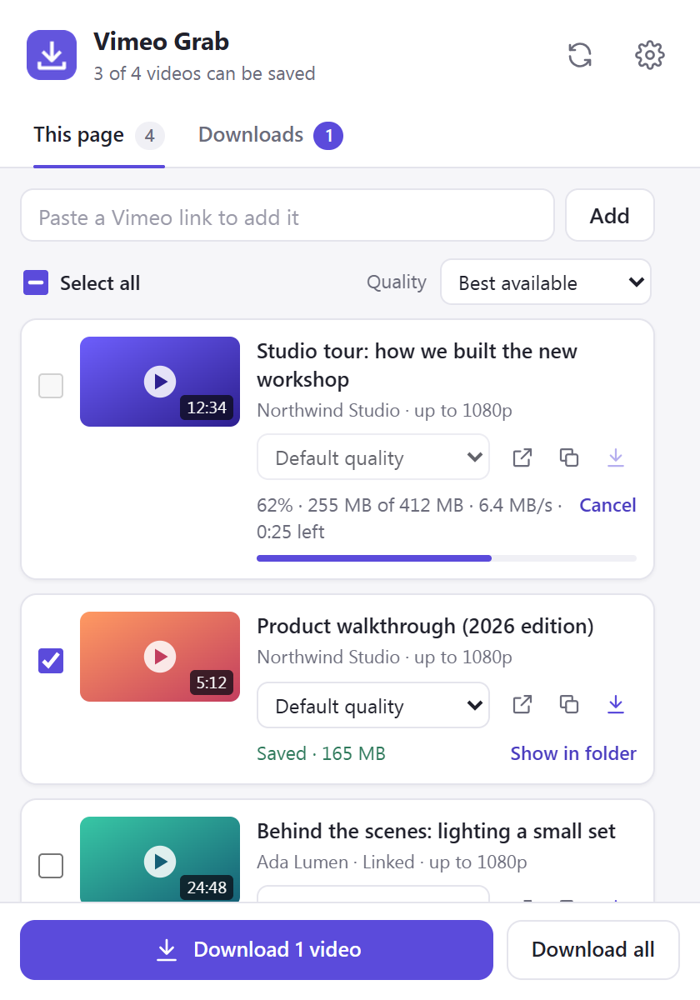
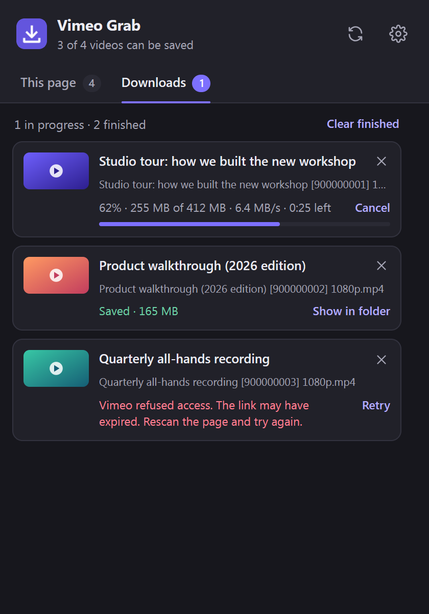

<p align="center">
  
</p>

<h1 align="center">Vimeo Grab</h1>

<p align="center">
  A Chrome extension that finds the Vimeo videos on the page you’re on and saves them as regular MP4 files: one, a few, or all at once.
</p>

<p align="center">
  <a href="https://github.com/grantzerlaut/vimeo-grab/actions/workflows/ci.yml"></a>
  <a href="https://github.com/grantzerlaut/vimeo-grab/releases/latest"></a>
  <a href="LICENSE"></a>
</p>

<p align="center">
  
  &nbsp;
  
</p>

## Features

- **Finds every Vimeo video on the page.** Embedded players (including ones inside other frames), links, lazy-loaded embeds such as `lite-vimeo` and Plyr, and the video on a vimeo.com page itself.
- **Real MP4 files.** Streams are joined into a standard MP4 (not a fragmented one) without re-encoding, so they open in QuickTime, VLC, Windows Media Player, Premiere and Resolve at full original quality.
- **Choose the quality.** Set a default (Best, Up to 1080p, Smallest…) or pick per video, with the approximate file size shown.
- **Audio only.** Save just the soundtrack as an `.m4a`.
- **Subtitles.** Optionally save the main track or every language as `.vtt` or `.srt` next to the video.
- **Batch downloads.** Select several videos or click *Download all*. Parts are fetched in parallel, and each download shows progress, speed and time remaining. Cancel or retry any of them.
- **Keeps going in the background.** Close the popup and keep browsing. The *Downloads* tab shows everything, from every tab, and the toolbar badge counts what’s in progress.
- **More ways in.** Paste a Vimeo link into the popup, right-click a Vimeo link and choose *Download Vimeo video*, or press <kbd>Alt</kbd>+<kbd>Shift</kbd>+<kbd>V</kbd>.
- **Your naming.** Choose the folder inside Downloads and a filename template such as `{title} [{id}] {quality}`. Assembled videos carry the title, creator and public Vimeo link in their tags.
- **Private by design.** No analytics, no accounts, no servers of its own. It only talks to Vimeo.
- **Light and dark mode**, keyboard accessible.

## Install

Vimeo Grab works in Chrome and other Chromium browsers (Edge, Brave, Opera, Vivaldi), version 130 or newer.

### From a release (recommended)

1. Download `vimeo-grab-<version>.zip` from the [latest release](https://github.com/grantzerlaut/vimeo-grab/releases/latest) and unzip it somewhere permanent, for example `Documents/vimeo-grab`.
2. Open `chrome://extensions` and turn on **Developer mode** (top right).
3. Click **Load unpacked** and choose the unzipped folder (the one containing `manifest.json`).
4. Pin Vimeo Grab from the puzzle-piece menu so it’s one click away.

Chrome loads the extension from that folder, so keep it where it is. To update, replace the folder’s contents with a newer release and click the reload icon on the extension’s card.

### From source

```bash
git clone https://github.com/grantzerlaut/vimeo-grab.git
```

Then follow steps 2–4 above, choosing the `extension` folder inside the clone.

## How to use it

1. Open a page with a Vimeo video and click the Vimeo Grab icon.
2. Videos embedded on the page are selected for you. Links to other videos are listed too, but left unticked.
3. Pick a quality (globally at the top, or per video), then click **Download**.
4. Files go to `Downloads/Vimeo/` by default, named like `My film [76979871] 1080p.mp4`.

If a video doesn’t show up, scroll to it or press play once, then click the rescan button. If a page won’t let extensions in (the Chrome Web Store, `chrome://` pages), paste the video’s link into the box at the top instead.

## Settings

Open them from the gear icon in the popup, or from the extension’s *Details → Extension options*.

| Setting | Default | |
| --- | --- | --- |
| Default quality | Best available | Best, Up to 4K/1440p/1080p/720p/480p, Smallest file, or Audio only |
| Folder | `Vimeo` | Inside your Downloads folder. Use `/` for subfolders; leave empty for Downloads itself |
| File name | `{title} [{id}] {quality}` | Tokens: `{title}` `{id}` `{quality}` `{owner}` `{date}` `{site}` |
| Ask where to save | Off | Shows Chrome’s Save dialog for each file |
| Write tags | On | Title, creator and public Vimeo link in the MP4’s metadata |
| Simultaneous downloads | 2 | 1–3 videos at a time; each fetches several parts in parallel |
| Subtitles | Don’t save | Main track, or every language |
| Subtitle format | WebVTT | Or SubRip (`.srt`) for editors and older players |

## What it can’t do

Vimeo Grab saves what your browser can already play, and nothing more:

- **DRM-protected videos** (some Vimeo OTT, On Demand and enterprise content) are marked *DRM-protected* and can’t be downloaded. Vimeo Grab doesn’t attempt to bypass DRM, and never will.
- **Private or password-protected videos** only work if you can watch them in this browser: sign in to Vimeo or unlock the video on its page first, then rescan.
- **Videos restricted to one website** (a common setting for course and company sites) can only be saved from that website, after the player has loaded there. Vimeo Grab reads the player that’s already on the page; it never pretends to be that site.
- **Live streams** can’t be saved while they’re live. Try again once the recording is published.
- It only scans the current page. It won’t crawl a whole site or follow links to other pages.

## Permissions

Chrome shows *“Read and change your data on all vimeo.com and vimeocdn.com sites”* when you install it. Here’s every permission and why it’s needed:

| Permission | Why |
| --- | --- |
| Access to `*.vimeo.com` and `*.vimeocdn.com` | Read the Vimeo player embedded in a page, and fetch video details and video files from Vimeo. No other sites. |
| `activeTab`, `scripting` | When *you* click the icon, scan that one tab for Vimeo videos. Nothing runs on pages until you do. |
| `downloads` | Save files to your Downloads folder and show them in their folder. |
| `offscreen`, `unlimitedStorage` | Join a stream’s video and audio parts into one MP4 in the background, using temporary disk space instead of memory, so long videos work. Temporary files are deleted as soon as each download finishes. |
| `storage` | Remember your settings, and the current list of downloads until you close the browser. |
| `contextMenus` | The right-click *Download Vimeo video* item. |

As a second line of defence behind the code’s own allowlist, the extension’s content security policy restricts its network requests to Vimeo’s hosts.

## Privacy

Vimeo Grab has no analytics, telemetry, ads or accounts, and it never sends anything to its authors. Your settings stay in Chrome’s local storage. The list of found videos and downloads lives in memory and is cleared when you close the browser.

When you open the popup, Vimeo Grab asks Vimeo about each video it found so it can show titles and qualities. Videos merely linked from the page are looked up anonymously. Your Vimeo sign-in is only used for videos you pick yourself (a pasted or right-clicked link, or the vimeo.com page you’re on). Videos it assembles include the title, creator and public Vimeo link in their tags, which you can turn off. See [PRIVACY.md](PRIVACY.md) for the full policy.

## Use it responsibly

Only download videos you have the right to save: your own uploads, videos the creator allows you to download, or content you’re otherwise licensed to keep. Respect creators’ rights and [Vimeo’s Terms of Service](https://vimeo.com/terms). You are responsible for how you use this tool.

Vimeo Grab is an independent project. It is not affiliated with, endorsed by, or sponsored by Vimeo, Inc. “Vimeo” is a trademark of Vimeo, Inc.

## Troubleshooting

<details>
<summary><strong>A video says “Vimeo refused access”</strong></summary>

The download links Vimeo hands out expire after a while. Vimeo Grab renews them automatically once; if that fails, click **Retry**. If the video only plays on its own site, reload that page so its player gets fresh links, then rescan.
</details>

<details>
<summary><strong>No videos are found</strong></summary>

Some sites only load their player when you scroll to it or click it. Do that, then press the rescan button. You can always paste the video’s link (from Vimeo’s *Share* button) into the box at the top of the popup.
</details>

<details>
<summary><strong>The download stopped when I closed Chrome</strong></summary>

Downloads run inside your browser, so they stop when it closes. Retry them from the *Downloads* tab next time.
</details>

<details>
<summary><strong>“Not enough free disk space”</strong></summary>

While a video is being assembled it briefly needs about twice its size in free space (the temporary copy plus the saved file). Free some space or choose a lower quality.
</details>

<details>
<summary><strong>Can I scan files on my computer?</strong></summary>

Turn on *Allow access to file URLs* on the extension’s details page in `chrome://extensions`.
</details>

Still stuck? [Open an issue](https://github.com/grantzerlaut/vimeo-grab/issues/new/choose) with your Chrome version, the extension version and the message you saw. Please don’t include links to private videos.

## Development

You need [Node.js](https://nodejs.org) 20 or newer. The extension itself has no build step and no runtime dependencies: `extension/` is exactly what Chrome loads.

```bash
npm install
```

```bash
npm test
```

| Command | What it does |
| --- | --- |
| `npm test` | Unit tests (Node’s built-in runner). The MP4 tests also decode the output with ffmpeg when it’s installed. |
| `npm run lint` | ESLint |
| `npm run check` | Lint, tests, and manifest/file-reference checks, as run in CI |
| `npm run build` | Packages `extension/` into `dist/vimeo-grab-<version>.zip` |
| `npm run test:e2e` | Loads the extension in Chrome for Testing and downloads real public Vimeo videos. Needs network access and `npx puppeteer browsers install chrome` once. |
| `node scripts/screenshots.mjs` | Regenerates the screenshots in `docs/screenshots` from demo data |
| `scripts/make-fixtures.sh` | Regenerates the synthetic test stream in `test/fixtures/hls` (needs ffmpeg) |

### How it works

```
popup ──SCAN──▶ service worker ──executeScript──▶ page + player frames (detector.mjs)
                     │  resolves each video: player config → HLS master → formats
                     │
popup ─DOWNLOAD─▶ service worker ──┬── direct MP4 ─────────────▶ chrome.downloads
                                   └── HLS stream ─▶ offscreen page
                                         fetch parts in parallel (stream.mjs)
                                         remux fMP4 → MP4 (mp4.mjs) into OPFS (sink.mjs)
                                         blob: URL ──────────────▶ chrome.downloads
```

| Path | |
| --- | --- |
| `extension/background.js` | Service worker: scanning, resolving videos, job queue, badge, context menu |
| `extension/offscreen/` | Background page that downloads and assembles streams |
| `extension/popup/`, `extension/options/` | The UI |
| `extension/lib/vimeo.mjs` | Vimeo URL recognition, player-config parsing, host allowlist |
| `extension/lib/hls.mjs` | HLS playlist parsing; refuses encrypted, live and discontinuous streams |
| `extension/lib/mp4.mjs` | Fragmented MP4 → regular MP4 remuxer (ISO/IEC 14496-12) |
| `extension/lib/stream.mjs` | Ordered parallel segment download into the remuxer |
| `extension/lib/detector.mjs` | The page scanner injected into the current tab |

More detail for contributors is in [docs/ARCHITECTURE.md](docs/ARCHITECTURE.md).

## Contributing

Bug reports, fixes and ideas are welcome. Please read [CONTRIBUTING.md](CONTRIBUTING.md) first. Security issues: see [SECURITY.md](SECURITY.md).

## License

[MIT](LICENSE)
